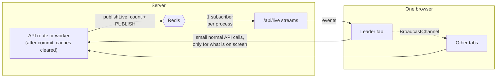

# Live updates: developer guide

How the app shows changes at once, without polling. Background and measurements: [performance-optimization-notification-plan.md](performance-optimization-notification-plan.md).

## 1. In one minute

- Every signed-in browser holds **one** server-sent-events connection: `GET /api/live`. Tabs share it.
- When something changes, the server sends a **signal**: what kind of thing changed, and its id. Never content.
- The browser then fetches what is on screen through the normal API, which checks access as always. Some events (the bell, sidebar dots) need no request at all.
- Postgres is the source of truth. A lost event only delays an update; it can't lose data.



## 2. Who hears what

The server chooses the channels from the **session** ([channels.ts](src/lib/live/channels.ts)). A browser can't ask for one, and an unknown role hears nothing shared.

| Area (browser) | Redis channel | Listeners |
|---|---|---|
| `user` | `live:user:<id>` | That person |
| `lab` | `live:lab:<clientId>` | Owner and sub-users of that lab |
| `labs` | `live:labs` | All labs |
| `staff` | `live:staff` | All staff |
| `support` | `sup:lab:<clientId>` or `sup:agents` | That lab, or the support agents |

## 3. Events

| Event | Sent by | What the browser does |
|---|---|---|
| `notification {unread}` | `notificationsChanged()` | Sets the bell. No request |
| `badge {key, on}` | `lightStaffBadge()`, `lightLabBadge()`, … | Sets that dot. No request |
| `badge` (no key) | `recheckLabBadges()` | Asks for the dots once, after 1–2.5 s |
| `case {ids}` | `invalidateCasesCache(clientId, caseIds)` | Lists: fetch those rows. Case page: refetch. Dashboards: refresh |
| `chat {caseId, kind}` | `publishChat()` | Open chat: fetch what is new. Lists: badge of that row |
| `chat-read {caseId}` | `publishChatRead()` | Badge off on the person's other devices |
| `message`, `ticket`, `read`, `typing` | `src/lib/support/realtime.ts` | Support ([guide](support-system.guide.md#8-real-time-updates)) |
| `hello {versions}`, `beat`, `logout` | The stream itself | Catching up, heartbeat, sign-out |

`case {ids: null}` means "reload": which cases changed isn't known, or there are more than 50.

## 4. Catching up

- Every counted event raises a number per channel in Redis (`ver:live:<channel>`) and carries it.
- On (re)connecting, `hello` says where the numbers stand. Only areas whose number moved are fetched again, spread over up to 5 s, so a deploy doesn't make everyone ask at once.
- A skipped number means a lost event: that area is fetched again too.
- The numbers are read **after** Redis confirmed the subscription, so nothing falls in between.
- **Hidden tabs** only mark data as stale and fetch when shown.

## 5. How often the browser asks

| | Live | Not live |
|---|---|---|
| Case lists | Changed rows, at most every 10 s | Every 60 s |
| Filtered case lists | Rows in place; "Updates available" for new matches | Every 60 s (admin: not) |
| Dashboards | On a change, at most every 30 s | Every 60 s |
| Case chat | At once, on an event | Every 15 s |
| Support thread / ticket / lists | At once, on an event | Every 8 / 20 / 30 s |
| Sidebar dots | Only for `badge` without a key | Every 60 s |
| Safety refresh | **Every 5 minutes** (`SAFETY_REFRESH_MS`) | – |

Only visible tabs ask. The open support widget also asks every minute whether support is online, because no event announces that.

## 6. Adding something

**A new event**
1. Publish it **after** the commit, and after clearing the caches it makes stale: `await publishLive(staffChannel, { type: 'invoice', id })`. It never throws.
2. Ids only. Choose the narrowest channel whose listeners may all see the thing.
3. Add the name to `EVENT_TYPES` in [client.ts](src/lib/live/client.ts). Otherwise the browser ignores it.
4. `{ counted: false }` only for what needs no catching up (typing).

**A new page or list**
```ts
useEffect(() => {
  const refresh = () => invalidateLive(queryClient, ['invoices'])
  const offs = [
    onLiveEvent((type) => type === 'invoice' && refresh()),
    onLiveResync('staff', refresh), // something may have been missed
  ]
  return () => offs.forEach((off) => off())
}, [queryClient])

useQuery({ …, refetchInterval: usePollInterval(60_000) })
```
- `useLiveRefresh(keys)` does this for dashboards, `useLiveCases(…)` for case lists.
- Use `usePollInterval` (a hook), not a fixed `refetchInterval`: it reacts at once when the connection goes up or down.
- Group frequent events and add a small random delay. Many people receive the same event in the same millisecond.

**A new write to a case** calls `invalidateCasesCache(clientId, caseId)`, which clears the caches first and announces it after. Without the id, every list reloads.

## 7. Files

| File | Job |
|---|---|
| [src/lib/live/names.ts](src/lib/live/names.ts), [channels.ts](src/lib/live/channels.ts) | Channel names; who hears what |
| [publish.ts](src/lib/live/publish.ts), [chat.ts](src/lib/live/chat.ts) | Sending. Opens no connection, so the worker can use it |
| [bus.ts](src/lib/live/bus.ts) | The one Redis subscriber of a process |
| [stream.ts](src/lib/live/stream.ts), [presence.ts](src/lib/live/presence.ts) | The streams, their heartbeat and limits; who is online |
| [client.ts](src/lib/live/client.ts) | Browser: leader election, events, catching up, status |
| [case-rows.ts](src/lib/live/case-rows.ts) | Putting fetched rows into a list |
| `src/hooks/useAppLive.ts`, `useLiveCases.ts`, `useLiveRefresh.ts`, `useCaseChatBadges.ts`, `useSidebarBadges.ts` | Use from pages |
| `src/app/api/live/route.ts`, `presence/route.ts` | The connection; "a tab is visible" |

## 8. Limits and behaviour

| Topic | Value |
|---|---|
| Streams per person | 10 (one per browser; room for crashes) |
| Heartbeat | 25 s; a silent minute makes the browser reconnect or another tab take over |
| Session | Signing out, deactivation and role changes close streams at once; also checked every 5 minutes |
| "Online" | A tab was **visible** in the last 6 minutes, not just an open connection |
| Refused (401, 429, off) | Polling, and another try after 60–90 s |
| Measured | 300 streams on two processes: ~0.3 MB each, under 1 % CPU idle, events in 5–17 ms, a restart rejoined in under 4 s (plan, §13, Phase 6) |

## 9. Operating

- **Turn it off:** `LIVE_UPDATES=off` and restart the web processes. `/api/live` answers 204, open browsers move to polling. `LIVE_UPDATES=staff` turns it on for staff only (for rolling out).
- **Watch it:** `curl -H "x-health-token: $HEALTH_TOKEN" …/api/health` shows, for the process that answered: open streams, streams dropped as too slow, events sent, the subscriber's state, memory.
- **nginx:** `/api/live` must not be buffered and needs long timeouts. `deploy/deploy.sh` writes this; the block to add by hand is in the plan, §13, Phase 1.
- **Processes:** restart the worker and the schedulers with the web processes: they send events too.
- **Is it working?** Browser tools → Network → `live`: status 200, type `eventsource`, a `beat` every 25 s.

| Symptom | Likely cause |
|---|---|
| Updates arrive in bursts | A proxy buffers `/api/live` |
| Updates only every minute | Not live: look at the status of `/api/live` (204 off, 401 session, 429 too many windows, 503 Redis) |
| One thing never updates live | Its write doesn't publish, or the event isn't in `EVENT_TYPES` |
| An update shows old data | It was published before the commit or before the cache was cleared |

## 10. Tests

```bash
SUPPORT_DB_TEST=1 DATABASE_URL=<local> REDIS_URL=redis://localhost:6380 RESEND_API_KEY=re_local_test_disabled npx vitest run live
```

They use real Postgres and Redis, and remove what they create. **Never point them at production.**
