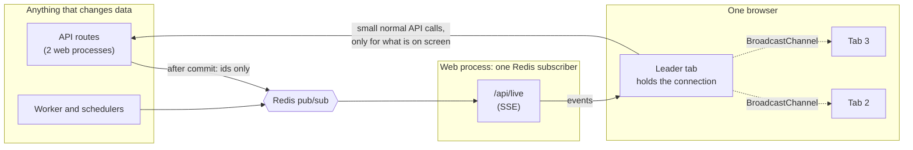

# Performance Optimization in Notifications: Plan

**Status:** approved with the recommendations (N1–N4). **Phases 0 to 4 implemented** (see §13); Phases 5 and 6 to do. N5 and N6 still need answers.

**Branch:** `perf/live-notifications`, from `no-supabase-rewrite`.

**Goal:** replace polling for notifications, badges, case chat, case lists and dashboards with server-sent events (SSE), so the browser asks the server only when something has actually changed.

---

## 1. Summary

**Yes, the platform still polls.** Only the support pages have live updates today. Everything else asks the server again on a timer, whether or not anything changed.

| Area | Today | After this plan |
|---|---|---|
| Case chat | Reloads the **whole conversation every 8 s** | Live; loads only the new messages |
| Notification bell and sidebar dots | Every 30 s, up to 45 s late | Live, normally with no request at all |
| Case lists | 84–94 KB every 30 s | Live; loads only the changed rows |
| Dashboards | Every 30–60 s | Refresh when something changed, at most every 30 s |
| Support | Already live | Moves onto the same connection; no more safety polling every 60 s |

**Expected result:** in the load model in §4, about **700 requests per minute from 100 open tabs** drop to about **90–210**, and the chat stops writing to the database when nobody has sent anything. These are estimates to be confirmed in Phase 6.

**Most of the chat saving needs no SSE.** Phase 0 is small fixes that can ship first.

**Four bugs found while reading the code** (§5) are fixed along the way.

---

## 2. What polls today

Every timer that calls the server, from reading the whole codebase:

| # | What | Interval | Where | Runs in hidden tabs? |
|---|---|---|---|---|
| P1 | Case chat thread | **8 s** | `CaseChat.tsx:97` | **Yes** |
| P2 | Sidebar dots and bell | 30 s | `useSidebarBadges.ts:18` | No |
| P3 | Case list: QC, designer, account manager | 30 s | `(ops)/cases/page.tsx:465` | **Yes** |
| P4 | Case list: admin | 30 s (not while filtered) | `admin/.../cases/page.tsx:418` | **Yes** |
| P5 | Case list: lab | 30 s | `client/.../cases/page.tsx:405` | **Yes** |
| P6 | Admin dashboard | 30 s | `admin/.../dashboard/page.tsx:24` | No |
| P7 | Lab dashboard | 30 s | `client/.../dashboard/page.tsx:30` | No |
| P8 | Ops dashboard: 5 requests | 60 s | `(ops)/dashboard/page.tsx:33` | No |
| P9 | Support list, thread, ticket, summary | 8–30 s offline, **60 s while live** | `support/api.ts` | No |
| P10 | Support metrics | 5 min | `support/api.ts:334` | No |

Also, **every page navigation** marks the menu item as seen and reloads the dots: one `PATCH`, then one `GET` that misses its cache and runs 8 queries.

"Hidden tabs" matters because P1, P3, P4 and P5 use plain timers. TanStack Query pauses in background tabs; those four do not (browsers slow them to about one run a minute).

**Not polling, so not in scope:** the notifications page (loads once, then reuses its data for 60 s), upload progress, and the background worker's own schedules.

---

## 3. Measured cost

Measured by running the real route handlers against a throwaway database, since deleted. It held 10,000 cases, 20,000 chat messages, 48,000 notifications and 2,400 support conversations, with 60 labs and 20 staff. The numbers are from a development PC, so read them **relative to each other**. They exclude the session check, rate limiting and network.

| Request | Queries | Writes | Response | Median |
|---|---|---|---|---|
| **Case chat, 200 messages** | **6** | **2** | **86.5 KB** | **28 ms** |
| Badges, cache miss | 8 | 0 | 0.1 KB | 10 ms |
| Badges, cache hit | 0 | 0 | 0.1 KB | 0.7 ms |
| Case list (admin), cache miss | 10 | 0 | 94 KB | 19.5 ms |
| Case list (admin), cache hit | 3 | 0 | 94 KB | 8.7 ms |
| Case list, filtered to "mine" | 10 | 0 | 94 KB | 11.5 ms |
| Case list (lab), cache hit | 3 | 0 | 84.5 KB | 6.7 ms |
| Admin dashboard, cache miss / hit | 13 / 1 | 0 | 3.5 KB | 24 / 2.3 ms |
| Lab dashboard, cache miss / hit | 7 / 1 | 0 | 2.6 KB | 9 / 2 ms |
| Ops dashboard, 5 parts, cache miss | 10 in total | 0 | ~1 KB | 27 ms in total |
| Support summary | 2 | 0 | 0.1 KB | 4–5 ms |

**Every request also makes 3 Redis round trips** in `proxy.ts` before its handler starts: the session, the ban check and the rate limit.

**One open case-chat tab with 200 messages, per hour, when nobody is chatting:** 450 requests, 2,700 queries, **900 database writes** and 38 MB (before compression).

**Three design points behind these numbers:**
- The chat has no "only what's new" option, so its cost grows with the length of the conversation.
- The case-list cache-hit cost of 3 queries is new: it came with the per-person chat badge fix (`1c982f1`). Before that it was 0, but showed people each other's badges. Phase 4 removes most of these requests.
- Filtered lists skip the cache entirely, and they still refresh every 30 s on the lab and ops pages.

---

## 4. Load model

**Assumption: 100 open, visible tabs.** Replace these with your real numbers; they only scale the result.

| Tabs | Page | Requests per tab per minute | Total |
|---|---|---|---|
| 30 | Lab, case list | 2 list + 2 badges + 1 support = 5 | 150 |
| 20 | Lab, case page with chat | 7.5 chat + 2 + 1 = 10.5 | 210 |
| 20 | Staff, case page with chat | 7.5 chat + 2 = 9.5 | 190 |
| 20 | Staff, case list | 2 list + 2 badges = 4 | 80 |
| 10 | Staff, ops dashboard | 5 + 2 = 7 | 70 |
| **100** | | | **700 per minute** (2,100 Redis round trips) |

Case-chat polling alone is 300 of the 700.

**After**, for the same tabs, with 10 chat messages and 10 case changes a minute:

| Source | Requests per minute |
|---|---|
| Safety refresh, every 5 min per tab (badges + page data) | ~40 |
| Chat: about 3 people have each conversation open | ~30 (about 1 KB each) |
| Case lists: changed rows only, at most one request per 10 s per tab | up to ~120 (about 1 KB each) |
| Dashboards: at most every 30 s | up to ~20 |
| **Total** | **~90 quiet, up to ~210 busy** |

**An honest limit:** on a busy day, staff case lists may make **as many requests as now or more**, but each is about 1 KB instead of 94 KB. The saving there is in data and database work, not in request count. For chat and badges, everything drops.

---

## 5. Bugs found during the review

| # | Bug | Effect | Fixed in |
|---|---|---|---|
| B1 | The chat marks itself **read while its tab is hidden**, on every poll | A forgotten background tab keeps clearing your unread badge and chat notifications, so you miss messages | Phase 0 |
| B2 | A new notification doesn't clear the cached sidebar dots. Reading a chat doesn't clear the cached unread count | The bell lights up to 45 s late; the unread number can be wrong for up to 60 s | Phase 0 |
| B3 | Auto-approve changes cases without clearing the caches | Dashboards can be wrong for up to **1 hour**, and lists for 5 minutes, after an automatic approval | Phase 0 |
| B4 | Agents are only connected while the Support page is open | Labs see "We'll reply when we're back" although agents are working elsewhere in the app | Phase 1 |

---

## 6. Options considered

| Option | For | Against | Verdict |
|---|---|---|---|
| **Extend the existing SSE stream** | Proven here across two server processes; one-way is all we need; passes through Cloudflare and nginx; reconnects by itself | One open connection per browser | **Recommended** |
| WebSockets | Two-way | Needs a custom Next.js server and its own auth; we don't need two-way | No |
| Poll less often | Trivial | Slower updates; still wasteful | Only as the fallback |
| Third-party push service | No servers to run | Cost, and customer activity leaves your infrastructure | No |

---

## 7. Design

### 7.1 One connection for everything



- **`/api/live` replaces `/api/support/stream`** and serves every signed-in role. Designers and other staff have no live connection at all today.
- **One connection per browser, not per tab.** Tabs elect a leader with the Web Locks API and share events through `BroadcastChannel`. Browsers without these fall back to one connection per tab.
- **Events are signals, never content,** exactly like support today. The stream can't leak text, and a lost event only delays an update.

### 7.2 Channels: who hears what

| Channel | Listeners | Events |
|---|---|---|
| `live:user:<id>` | That person | `notification`, `chat`, `badge`, `logout` |
| `live:lab:<clientId>` | That lab's people | `case`, `chat`, support events |
| `live:staff` | All staff | `case` |
| `live:agents` | Admin, QC, account manager | Support events, including internal notes |
| `live:labs` | All labs | `offer`, `tutorial` |

The server picks the channels from the **session**. The browser can't ask for one.

**Case chat** events go to the lab's channel, to each staff member assigned to the case, and to admins: the same rule as `canAccessCaseChat`.

### 7.3 Events and what the browser does

| Event | Sent when | Browser reaction |
|---|---|---|
| `notification` | Notification created, read, edited or removed | Set the bell from the event (`unread: true/false`). Refetch the list only if that page is open |
| `badge {key}` | New case, client, invoice, offer, claim or tutorial | Light that dot. **No request** |
| `chat {caseId}` | Message sent, edited or deleted | Chat open: fetch only what's new. Otherwise: update that row's chat badge |
| `case {caseId}` | Case created, changed or deleted | List: refetch that row, grouped. Case page: refetch it. Dashboard: refresh, at most every 30 s |
| `message`, `ticket`, `read`, `typing` | Support, unchanged | Unchanged |
| `logout` | Session ended or revoked | Close, go to sign-in |

### 7.4 Where events are sent from

There are few places, because the code already has central points:

| Central point | Covers |
|---|---|
| `NotificationService.dispatchMany` + the read/edit/delete code | Every notification |
| `invalidateCasesCache()` (15 call sites) | Every case change, plus auto-approve once B3 is fixed. Gains a `caseId` |
| `announceChatMessage()` and `chat-modify.ts` | Every case chat change |
| Sign-up, invoice, offer, claim and tutorial creation | The remaining dots |
| `destroyAllSessions()` | Immediate logout and role changes |

All are sent **after** the database commit, never block it, and can't make it fail.

### 7.5 Catching up after a disconnect

Refetching everything on reconnect would cause a **stampede** after each deploy. Instead:
- The cache already keeps version counters in Redis (`ver:cases:…`). On connect, the server sends the current ones.
- The browser refetches **only the areas whose number changed**, after a random 0–5 s delay.
- Notifications and chat get a counter of their own.

### 7.6 Protecting the server

| Risk | Protection |
|---|---|
| A burst of case changes | Grouped in the browser: at most one list refresh per 10 s, one dashboard refresh per 30 s |
| Hidden tabs | Only mark data as stale; fetch when the tab is shown again |
| Everyone fetching at the same instant | Random delay of 0–3 s for lists and dashboards (none for chat) |
| Live updates off or unavailable | Slow polling takes over: chat 15 s, the rest 60 s, only in visible tabs |
| Emergency | `LIVE_UPDATES=off` makes `/api/live` answer 204; browsers stop reconnecting and use slow polling |

---

## 8. Phases

Each phase ships alone and can be rolled back alone.

### Phase 0: Quick wins, no SSE

| Change | Files |
|---|---|
| Chat loads the latest 50 messages, then **only newer ones**; older ones on request. Edits and deletes are picked up by change time | `chat/route.ts`, `chat-messages.ts`, `CaseChat.tsx` |
| **B1:** mark read only when the tab is visible and there is something new; a separate call, so plain loading writes nothing | `chat/route.ts`, `CaseChat.tsx` |
| **B2, B3:** clear the right caches | `notification-service.ts`, `chat/route.ts`, `auto-approve-task.ts` |
| P3, P4 and P5 stop while the tab is hidden, and refresh when it's shown | 3 case pages |
| Mark a page as seen **only if its dot is on**; update it locally instead of recomputing 8 counts | 5 sidebars, `useSidebarBadges.ts` |
| ~~Chat, dashboards and support stop loading the profile~~ Changed, see §13 | |

**Database:** one small migration: a `changed_at` column on `chat_messages` with an index on `(case_id, changed_at)`.

**Done when:** an idle chat poll does **0 writes** and returns **under 1 KB**; a hidden chat tab never marks anything read; opening a page whose dot is off makes no badge request.

### Phase 1: One live connection

- `src/lib/live/`: channels, publish, hub, presence, versions (generalised from `support/realtime.ts`).
- `/api/live`, a client `LiveProvider` with leader election, and the fallback polling helper.
- Support moves onto it. `/api/support/stream` stays for one release for tabs that are still open.
- **B4:** agents count as online anywhere in the app.
- One heartbeat timer per process instead of one per stream.
- Deploy: an nginx `location /api/live` with buffering off and long timeouts, and higher `worker_connections` (not set today; each stream uses two connections).

**Done when:** all support tests pass unchanged; 5 tabs open 1 connection; signing out everywhere closes the stream within 2 s.

### Phase 2: Notifications and badges

- `notification` and `badge` events; the bell and dots update without requests.
- P2 drops from every 30 s to every 5 min as a safety net.

**Done when:** the bell lights within 1 s in another process; an idle tab makes no badge requests for 5 min; reading in one tab clears the others.

### Phase 3: Case chat

- `chat` event; P1 is removed while live.
- The chat badge on lists updates per row.

**Done when:** messages, edits and deletes appear within 1 s; someone without access receives nothing; an idle open chat makes no requests.

### Phase 4: Case lists and dashboards

- `GET /api/cases?ids=…`: returns only the listed rows, at most 50, with the same access rules as the full list.
- `case` event; P3–P8 removed while live. Filtered lists show **"Updates available, refresh"** instead of reordering under the user.
- Ops dashboard: its 5 sections refresh only if they changed.

**Done when:** a status change shows on other people's lists within 10 s without a full reload; a row someone may no longer see disappears.

### Phase 5: Clean-up

- Support polling from 60 s to 5 min while live (P9).
- Remove the old support stream and unused code (`AppSidebar`, `SubSidebar` and `SubLayout` after confirming nothing uses them).
- Update `support-system.guide.md` and add a short guide for live updates.

### Phase 6: Load test and rollout

- Repeat the §3 measurements, then a test with 300 simulated connections across two processes: memory, CPU, Redis, delivery delay, a deploy, a Redis restart.
- Roll out behind `LIVE_UPDATES`: staff first, then labs.

| Phase | Size | Risk | Depends on |
|---|---|---|---|
| 0 Quick wins | Medium | Low | – |
| 1 Connection | Large | Medium | – |
| 2 Notifications and badges | Small | Low | 1 |
| 3 Case chat | Medium | Low | 0, 1 |
| 4 Lists and dashboards | Large | Medium | 1 |
| 5 Clean-up | Small | Low | 2–4 |
| 6 Load test | Medium | – | 1–4 |

---

## 9. Targets

| Measure | Today | Target |
|---|---|---|
| Requests per min, idle chat tab (lab) | 10.5 | ≤ 0.5 |
| Database writes per hour, idle chat tab | 900 | 0 |
| Data per hour, idle chat tab with 200 messages | 38 MB | < 0.2 MB |
| Data per hour, idle admin list tab | 11 MB | < 1.5 MB |
| New notification visible | up to 45 s | ≤ 1 s |
| New chat message visible | up to 8 s | ≤ 1 s |
| Connections per browser | 1 per tab (labs, support pages only) | 1 |
| Memory per open connection | not measured | ≤ 50 KB, confirmed in Phase 6 |

Phase 6 adds simple counters (open streams, events per minute, fallback rate) to the health endpoint, so the numbers can also be checked in production.

---

## 10. Security

- Channels come from the server's session, never from the browser.
- Events carry ids only: no names, text or amounts. Support's "is typing" keeps its name, as today.
- Every refetch goes through the normal permission checks.
- A role or lab change, deactivation or password reset revokes sessions, which closes the stream at once. The 5-minute check stays as a backstop.
- Tests prove that lab A never receives lab B's events, labs never receive staff-only events, and designers never receive support events.

## 11. Risks

| Risk | Mitigation |
|---|---|
| Cloudflare or nginx closes idle connections | 25 s heartbeat (already in use); dedicated nginx location |
| Redis down | No events; slow polling takes over; nothing is lost |
| A deploy reconnects everyone at once | Versions (§7.5), random delay, streams closed cleanly on shutdown |
| A missed `publish` call in future code | Only central points publish; tests cover each; 5-minute safety refresh |
| The leader tab is closed or frozen | The lock is released and another tab takes over; a watchdog asks for a new leader if no heartbeat arrives for 60 s |
| A list changes while someone is working in it | Rows update in place; filtered lists never reorder by themselves |

**Rollback:** set `LIVE_UPDATES=off` and restart. No data migration has to be undone.

---

## 12. Decisions needed

| # | Question | Recommendation |
|---|---|---|
| N1 | Ship Phase 0 first, on its own? | **Yes.** Biggest saving for the least risk, and it fixes three bugs |
| N2 | Filtered case lists: update by themselves, or show "Updates available"? | **Show "Updates available"** |
| N3 | Do case lists and dashboards (Phase 4) go live too, or only notifications and chat? | **Yes, but after 2 and 3**, when their effect is measured |
| N4 | Safety refresh while live | **Every 5 minutes** |
| N5 | Roughly how many people use the app at once, at peak? | Needed to size the load test (300 connections assumed) |
| N6 | Is nginx set up by `deploy.sh`, or changed by hand? | Needed before Phase 1 |

---

## 13. Implementation status

### Phase 0: Quick wins (done)

Measured again on the §3 data:

| Case chat, 200 messages | Before | After |
|---|---|---|
| First load | 6 queries, 2 writes, 86.5 KB, 28 ms | 3 queries, 0 writes, 21.5 KB, 7 ms |
| **Idle refresh, every 8 s** | **6 queries, 2 writes, 86.5 KB** | **2 queries, 0 writes, 0.05 KB**, 4 ms |
| One idle tab per hour | 900 writes, 38 MB | 0 writes, 0.02 MB |

- **Chat:** `GET /chat` returns the newest 50, `?before=` older ones, `?since=` only what changed. A trigger keeps `changed_at` right. Changes overlap by 10 s, so a message committed late is never missed; the browser merges by id.
- **B1:** `POST /chat/read {messageId}` marks read up to a message. Sent once, and only while the chat is visible.
- **B2, B3:** fixed. A message and its attachment are now also saved together.
- **Hidden tabs:** the chat and the three case lists stop (`useVisibleInterval`) and refresh at once when shown.
- **Dots:** a page is marked seen only if its dot is on. The bell and Support dots are real unread counts, so visiting never clears them.
- **Also fixed:** the chat box ignored its height and grew with the conversation; it is a 360 px scrolling box again (400 px in the admin dialog).

**Changed from the plan:** the profile lookups stay, as a second check on top of the session. In the chat it is joined into the case query, so it costs nothing extra.

**Tests:** 7 new database tests; 263 in total pass. Browser, production build: 15/15 for Phase 0, and the 25 earlier chat checks again.

**Deploy:** run `20261126000100_chat_incremental.sql` before the new code.

### Before Phase 1: losing access takes effect at once (done)

The live stream relies on sessions ending (§10), so these came first:
- **Deactivating a lab** now signs out its owner and every sub-user, on every device. If that fails, the admin is told, and repeating the request finishes the job.
- **A sub-user of an inactive lab can't sign in.** Only the sub-user's own status was checked before.
- **Signing in at the moment of deactivation or deletion** no longer leaves a working session.
- **The team page's on/off switch** works again: it was refused because it sends no phone number, so staff couldn't be deactivated there.

Correction: an earlier version of this section said deleting a sub-user left their sessions working. It doesn't; deletion always revoked them.

Tests: `auth-revocation.integration.test.ts` (8, real Postgres and Redis; 7 of them fail on the old code).

### Phase 1: One live connection (done)

- **Server** (`src/lib/live/`): `publish` (no extra connection, usable from the worker), `bus` (one Redis subscriber per process), `presence`, `stream` (`/api/live`, one timer per process). Channels come from the session through an allow-list of roles.
- **Browser** (`src/lib/live/client.ts`): tabs elect a leader that holds the only connection and passes events on. A closed leader is replaced at once, a frozen one after about a minute.
- **Catching up:** events carry a counter. On (re)connecting, the server says where the counters stand, and only areas that moved are reloaded, spread over a few seconds. The versions are read only after Redis confirmed the subscription, so nothing falls in between. The same happens after a Redis restart.
- **Support** runs on it. `/api/support/stream` stays for one release, for tabs that are still open.
- **Losing access:** `destroySession` and `destroyAllSessions` close the matching streams at once.
- **Hidden tabs** only mark data as stale and load it when shown.
- **Kill switch:** `LIVE_UPDATES=off`.

**Decided while building:**
- **"Online" means a visible tab, not an open connection.** Otherwise a tab forgotten overnight would show support as online and stop that person's emails. Visible tabs report every 4 minutes (`POST /api/live/presence`, Redis only).
- **The limit is 10 streams per person** (was 5): after a crash, dead connections count for up to 90 s.
- The `live:labs`, `live:lab` and `live:staff` channels exist but carry nothing until Phase 2.

**Tests:** `live.integration.test.ts` (12, real Redis); all earlier support tests pass unchanged; 283 in total. Browser, two production processes: 18/18 for Phase 1 (5 tabs on 1 connection; events across processes in about 0.1 s; leader closed and frozen; server restarts; kill switch; deactivation reaches every open tab in 0.15 s), and the 16 earlier two-process support checks again.

**Deploy:** no migration. `deploy.sh` now has an nginx location for `/api/live` and raises `worker_connections` to 4096. If nginx was changed by hand (N6), add this to the `server` block:

```nginx
location ~ ^/api/(live|support/stream)$ {
    proxy_pass http://127.0.0.1:4000;
    proxy_http_version 1.1;
    proxy_set_header Connection '';
    proxy_set_header Host $host;
    proxy_set_header X-Real-IP $remote_addr;
    proxy_set_header X-Forwarded-For $proxy_add_x_forwarded_for;
    proxy_set_header X-Forwarded-Proto $scheme;
    proxy_buffering off;
    proxy_cache off;
    gzip off;
    proxy_read_timeout 1h;
    proxy_send_timeout 1h;
}
```

It also works without this (25 s heartbeat, unbuffered by header); the location makes it robust.

### Phase 2: Notifications and badges (done)

- **The bell:** `notificationsChanged()` is the one place to call after notifications were created, read, edited or removed. It clears the caches and sends `{notification, unread}` to each person, so their tabs set the bell without asking. An open notifications page refreshes itself.
- **Dots a single event decides** (new case, client, invoice, offer, claim, tutorial) are set directly, with no request. Opening a page turns its dot off on the person's other devices too.
- **A lab's Cases dot and the Support dot** depend on more, so those events mean "ask again": one small request per burst, after 1–2.5 s, only in visible tabs.
- **P2** polls every 5 minutes while live (60 s otherwise) instead of every 30 s. A failed request keeps the dots shown so far instead of clearing them.
- **The cached answer carries a version** made of the person's event counters, so it can never hide a change. It lasts 60 s instead of 15 s. The Support dot isn't cached.
- Events now name their area, so each channel is caught up separately.

**Tests:** `live-badges.integration.test.ts` (11, real routes, Postgres and Redis); 294 in total. Browser, two production processes: 15/15 (bell in another process and every tab at once, without a request; 95 s idle: 0 badge requests in 5 tabs, 3 per tab before), and the Phase 0, Phase 1 and chat checks again (15, 18 and 25).

**Deploy:** no migration. Restart the worker and the schedulers too: they send notification events.

### Phase 3: Case chat (done)

- **Events:** `chat {caseId, kind}` after every message, edit and delete (and the rejection line), to the lab's channel, the staff on the case, and admins: the same people as `canAccessCaseChat`. `chat-read {caseId}` goes to one person's own devices.
- **The open chat** refreshes at once with `?since=`, one refresh at a time, and once more if something arrived meanwhile. A hidden chat loads when shown. After a lost connection it catches up.
- **P1** polls every 5 minutes while live, every 15 s otherwise.
- **List badges** change per row, without a request. One's own message leaves none.
- A deleted message doesn't take the badge off lists at once; since Phase 4 the list refetches that row.

**Tests:** `live-chat.integration.test.ts` (7); 301 in total. Browser, two production processes: 17/17 (messages, edits and deletes in under 0.1 s; 12 messages at the same moment all shown; 40 s idle: 0 requests, 5 before), an open chat through a server restart, and Phase 1, Phase 2 and edit/delete again (18, 15, 25).

**Deploy:** no migration.

### Phase 4: Case lists and dashboards (done)

- **The event:** `case {ids}`, sent by `invalidateCasesCache(clientId, caseIds)` to staff and to that lab, after every case write (also auto-approval, bulk output, files, downloads and deleting a lab). It clears the cached lists and the cached case first and sends the event after, so whoever asks on hearing it gets the new state. More than 50 ids, or unknown: `ids: null`, "reload". Staff downloads are announced to staff only.
- **`GET /api/cases?ids=…`:** 1 to 50 ids, same access rules and fields as the list, never cached. With filters it also says which of the rows match (`matching`).
- **Lists (P3–P5):** changed rows are fetched on their own, grouped: after 0–3 s, at most every 10 s per tab. New cases go to their place, waiting ones to the top, rows no longer returned disappear. A longer list reloads its loaded pages when a row leaves them, so that "Load more" skips none. The open case window of the admin list follows.
- **Filtered lists** change in place only; a new match shows "Updates available" with a Refresh button. Rows that stop matching a status filter are hidden, as before.
- **Case page:** refetches after 0.3–1.3 s. A refresh that fails leaves the page (it used to replace it by the error); a deleted case says so.
- **Dashboards (P6–P8):** refresh 0–3 s after a change, then at most every 30 s.
- **While live**, lists and dashboards poll every 5 minutes (filtered lists not at all); otherwise every 60 s, visible tabs only.

**Decided while building:**
- **The ops dashboard refreshes all 5 sections on a case change**, because nearly every change touches most of them and their answers are cached on the server. "Only if changed" holds for time without changes: no requests at all.
- **Deleting a lab** now also clears the cached staff lists; its cases stayed on them for up to 5 minutes.

**Tests:** `live-cases.integration.test.ts` (13) and `case-rows.test.ts` (9); 323 in total. Browser, two production processes: 29/29 (a change reaches three roles' lists in 4–8 s with one request each; 30 changes cost 4 list requests per tab; 65 s idle: 0 requests, 2 per tab before; case page in 0.9 s; server restart; kill switch), and the Phase 1, 2, 3 and edit/delete checks again (18, 15, 17, 25).

**Deploy:** no migration. Restart the worker and the auto-approve scheduler too: they send case events.
