# Support System Guide

How IconicConnect's support system works, why it exists, and how it is built: from the big picture down to tables, files and edge cases.

> **Audience:** product, support leads and developers.
>
> - Sections 1–4 are for everyone.
> - Sections 5–12 go into the engineering detail.
> - Section 15 is the quick reference.
>
> **Related:** [`support-system.md`](support-system.md) is the design plan and per-phase build log. This guide describes the system as built.

---

## Contents

1. [What it is, in one minute](#1-what-it-is-in-one-minute)
2. [Why it matters for the product](#2-why-it-matters-for-the-product)
3. [Who uses it and what they can do](#3-who-uses-it-and-what-they-can-do)
4. [A conversation's life](#4-a-conversations-life)
5. [Architecture overview](#5-architecture-overview)
6. [Database design](#6-database-design)
7. [Key workflows, step by step](#7-key-workflows-step-by-step)
8. [Real-time updates](#8-real-time-updates)
9. [Attachments (up to 500 MB)](#9-attachments-up-to-500-mb)
10. [Reply-time targets (SLA), auto-close, emails and ratings](#10-reply-time-targets-sla-auto-close-emails-and-ratings)
11. [Security and privacy](#11-security-and-privacy)
12. [Critical cases and how they are handled](#12-critical-cases-and-how-they-are-handled)
13. [Files: where everything lives](#13-files-where-everything-lives)
14. [API reference](#14-api-reference)
15. [Configuration, limits and defaults](#15-configuration-limits-and-defaults)
16. [Testing](#16-testing)
17. [Operating it](#17-operating-it)
18. [Known limits and what's next](#18-known-limits-and-whats-next)
19. [Glossary](#19-glossary)

---

## 1. What it is, in one minute

Support is a **conversation** between a dental lab and the IconicConnect team, like a chat thread rather than a one-off form.

- A lab member starts a conversation from the **Support page** or the **floating chat widget**, available on every lab page.
- Support agents work all conversations from one **inbox**. They can:
  - take ownership
  - reply
  - leave **internal notes** the lab never sees
  - attach files, up to 500 MB per file and 10 per message
  - close the conversation
- Everything updates **live**: new messages, "is typing…", "Seen", and status changes.
- The system keeps support accountable:
  - **reply-time targets** with alerts
  - **auto-close** for conversations where the lab went quiet
  - **email summaries** for people who are away
  - a **rating** after each conversation
  - **team metrics**

A conversation has only three statuses:

| Status | Meaning |
|---|---|
| **New** | The lab is waiting for support to pick it up |
| **Live** | Support is engaged; messages go back and forth |
| **Closed** | Done. The lab can still reopen it within 14 days by replying |

Two badges show **whose turn it is**:
- **Waiting on support**: the lab spoke last.
- **Waiting on lab**: support spoke last.

---

## 2. Why it matters for the product

| Problem before | What the new system does | Product impact |
|---|---|---|
| A ticket was one message plus a status, and back-and-forth happened elsewhere (email, phone) | A full threaded conversation with files, in the product | Context stays in one place; fewer lost details, faster resolution |
| Labs couldn't tell whether anyone was looking | Live updates, "Seen" receipts, typing indicator, "We're online" | Labs feel heard; fewer duplicate tickets and chasers |
| Big scan files and screen recordings couldn't be shared | Files up to 500 MB go straight to cloud storage; videos stream and seek | Problems are diagnosed from the actual file or video, not a description |
| Nobody owned a ticket; nothing was measured | Assignment, "Mine / Unassigned / Overdue" views, reply-time targets, alerts | Predictable response times; issues don't fall through the cracks |
| Agents had no customer context | Side panel with the lab's details, recent cases and other conversations | Faster, better answers without switching screens |
| Repeated answers typed by hand | Saved replies with `/` shortcuts and name placeholders | Consistent tone, saves agent time |
| Old tickets piled up forever | Auto-close after 7 days of no reply (with a warning) | A clean inbox that reflects real work |
| No feedback loop | 1–5 rating and comment after each conversation; 30-day metrics | Quality is visible and can be improved |

**How to measure success** (all available from `GET /api/support/metrics`):
- Median time to first reply.
- Percentage of first replies within target.
- Average rating.
- Conversations created, closed and auto-closed.
- Overdue right now.

---

## 3. Who uses it and what they can do

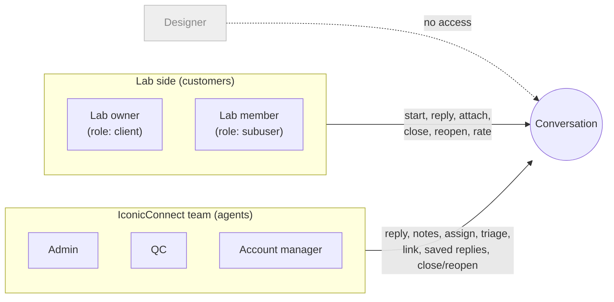

| Capability | Lab owner / member | Agent (admin, QC, account manager) | Designer |
|---|---|---|---|
| See conversations | All of **their own lab's** (D2) | **All** labs (D3) | None (D10) |
| Start a conversation | For their lab | On behalf of any lab (D9) | — |
| Reply, attach files | ✓ | ✓ | — |
| Internal notes | Never see them | ✓ | — |
| Close | ✓ ("Mark as solved") | ✓ with a reason | — |
| Reopen | By replying, within 14 days | Any time | — |
| Assign, take it, priority, topic | — | ✓ | — |
| Link related conversations | Sees the link | ✓ | — |
| Saved replies | — | Own ones; admins also manage **shared** ones | — |
| Lab side panel, metrics, reply deadlines | — | ✓ | — |
| Rate the conversation | ✓ once, after close | Sees the rating | — |

**Where each person works:**

| Who | Page | Also |
|---|---|---|
| Lab | `/client/support` | Floating widget on every other lab page |
| Admin | `/admin/support` | |
| QC / account manager | `/support` | |

All rules live in one file, [`src/lib/support/policy.ts`](src/lib/support/policy.ts). Every API route and every write goes through it.

---

## 4. A conversation's life

### 4.1 Status machine

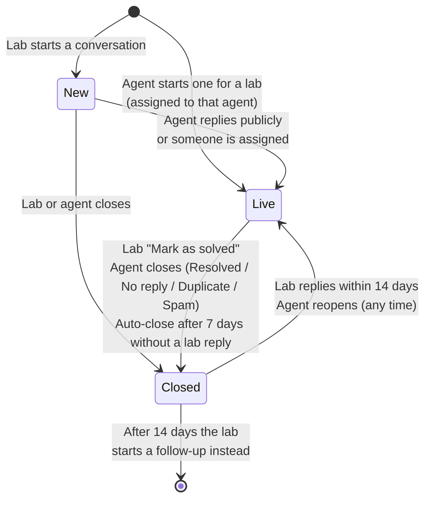

**Rules worth knowing:**
- An **internal note** never changes the status and never counts as a reply.
- **Every change is recorded** as an audit event in `sup_events`. Public changes also add a centred **system line** in the thread, such as "Conversation closed by Priya (Resolved)". Priority and topic changes are internal: they are audited but not announced.
- **A reply on a closed conversation reopens it** in the same step. The "reopened" line is written first so the thread reads in order.

### 4.2 A typical timeline

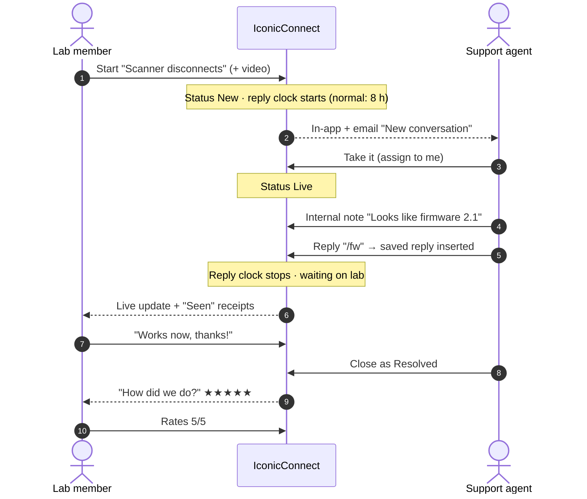

---

## 5. Architecture overview

### 5.1 The big picture

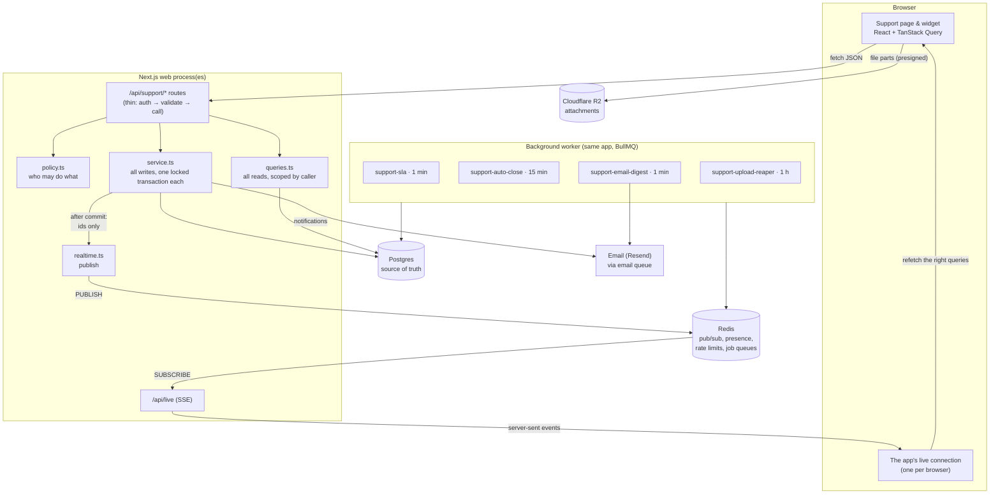

### 5.2 Layers and their one job each

| Layer | File(s) | Responsibility | Touches the DB? |
|---|---|---|---|
| Vocabulary | `constants.ts`, `types.ts` | Statuses, labels, limits, shared types (safe for the browser) | No |
| Rules | `policy.ts`, `lifecycle.ts`, `sla.ts`, `upload-policy.ts` | **Pure functions:** who may act, what a change does, deadlines, allowed files | No |
| Boundary | `validation.ts`, `http.ts` | zod schemas, auth, error mapping, rate limits | No |
| Read side | `queries.ts`, `agent-tools.ts` (context, metrics) | Every read, scoped by caller; internal notes filtered here | Read |
| Write side | `service.ts`, `attachments.ts`, `agent-tools.ts` (saved replies), `digest.ts` (email bookkeeping) | Every change, in a transaction with the ticket row locked; audit; publish after commit | Write |
| Side effects | `notify.ts`, `realtime.ts`, `digest.ts` | In-app and email notifications, live events, presence | — |
| HTTP | `src/app/api/support/**` | Thin routes: `requireSupportActor` → `parse*` → service/query → JSON | via the above |
| UI | `src/components/support/**` | Workspace, widget, thread, composer, panels | via the API |

**Why this shape:**
- The rules are pure, so they're cheap to unit-test and impossible to bypass: the routes have no logic of their own.
- Writes lock the ticket row, so two people acting at once can't corrupt the state.
- Live events carry **ids only**, so the stream can never leak content: the browser refetches through the normal permission-checked API.

---

## 6. Database design

All support tables start with `sup_`. They are created by four dbmate migrations in `db/migrations/`:

| Migration | Adds |
|---|---|
| `20261122000100_support_system.sql` | Enums, tickets, messages, reads, events, and the import of old tickets |
| `20261122000200_support_attachments.sql` | Attachments (linked to the shared `files` registry) |
| `20261123000100_support_canned_replies.sql` | Saved replies, plus 3 shared ones |
| `20261124000100_support_sla_csat.sql` | Reply-time policies, clock columns, email digests, backfill |

Drizzle definitions: [`src/db/schema/support.ts`](src/db/schema/support.ts).

### 6.1 Entity-relationship diagram

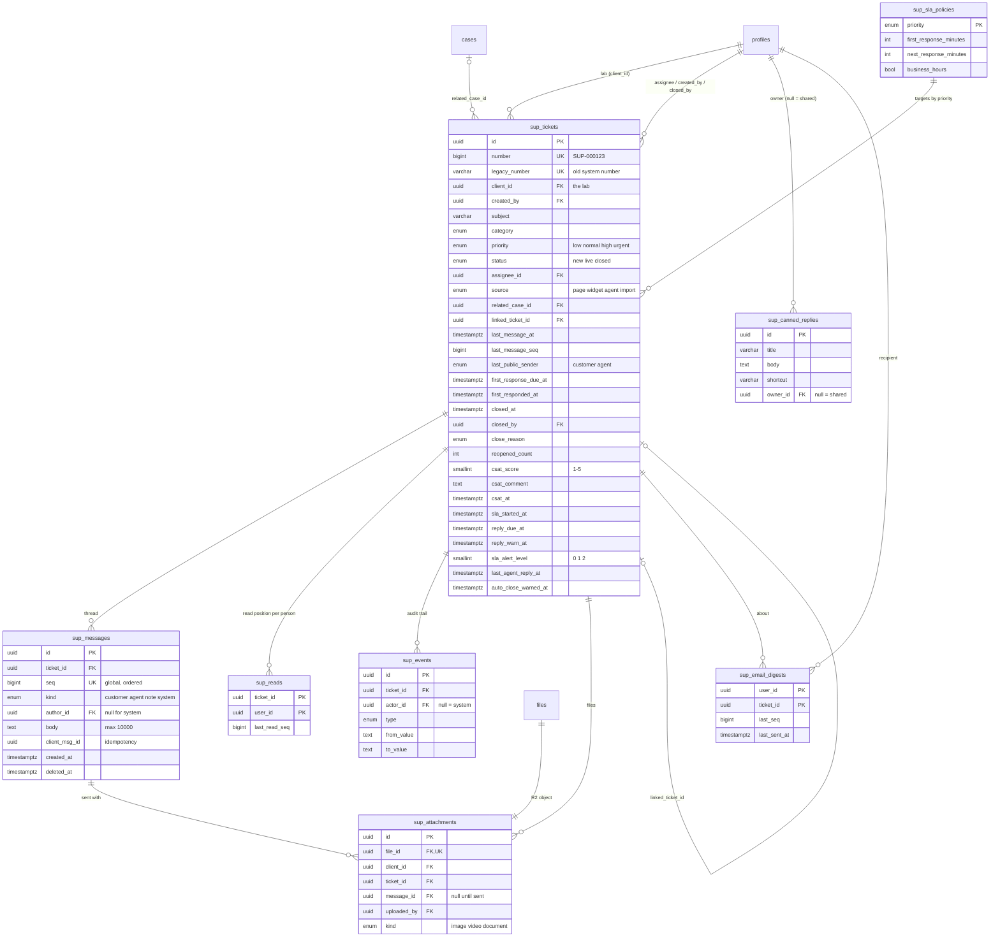

### 6.2 Table by table

#### `sup_tickets`: one row per conversation

**Columns by group:**

| Group | Columns |
|---|---|
| Identity | `id`, `number` (shown as `SUP-000123`), `legacy_number` (imported tickets keep their old number) |
| Ownership | `client_id` (the lab), `created_by`, `assignee_id` |
| Triage | `category`, `priority`, `status`, `source`, `related_case_id`, `linked_ticket_id` (same lab only) |
| Activity (denormalised for fast lists) | `last_message_at`, `last_message_seq` (newest *public* message), `last_public_sender` (drives "whose turn") |
| Closing | `closed_at`, `closed_by`, `close_reason`, `reopened_count` |
| Reply clock | `first_response_due_at`, `first_responded_at`, `sla_started_at`, `reply_due_at`, `reply_warn_at`, `sla_alert_level` |
| Auto-close | `last_agent_reply_at`, `auto_close_warned_at` |
| Rating | `csat_score`, `csat_comment`, `csat_at` |

**Constraints:**
- A closed conversation **always** has a close time and reason, and an open one never does.
- A running clock always has all three deadline fields: start, due, and warn.

**Indexes and what uses them:**

| Index | Used by |
|---|---|
| `(client_id, last_message_at DESC)` | Lab's list |
| `(status, priority, last_message_at DESC)` | Inbox |
| `(assignee_id, status)` | "Mine" |
| Full-text index on `subject` | Search |
| Partial index on `reply_due_at` | SLA job, overdue counts |
| Partial index for "waiting on lab" | Auto-close job |
| `last_message_at` | Digest job |

#### `sup_messages`: the thread

- **`seq`** is a single global sequence, so it gives a total order. It powers:
  - paging ("before" and "after")
  - read receipts
  - "unread" checks
  - live refetches
- **`kind`:**

  | Kind | Visible to | Notes |
  |---|---|---|
  | `customer` | Everyone | |
  | `agent` | Everyone | |
  | `note` | Agents only | Filtered in SQL for labs |
  | `system` | Everyone | Never has an author |

- **`client_msg_id`** is generated by the browser and protected by a unique index on `(ticket, author, client_msg_id)`. A retried send, such as a double click or a flaky network, is stored **once**.
- A full-text index on `body` powers search, which only covers notes for agents.

#### `sup_reads`: where each person stopped reading

- One row per (conversation, person), holding the highest `seq` read.
- It **never moves backwards** (`greatest(...)`).
- It drives the unread dots, the unread badge, "Seen" receipts, and whether the email digest should include a message.

#### `sup_events`: the audit trail

Records `created`, `status`, `assignee`, `priority`, `category`, `reopened`, `linked`, `rated` and `auto_closed`, each with its from/to values and who did it (`null` means the system).

#### `sup_attachments`: files on messages

- Each row points to a row in the shared **`files`** registry (`kind = 'support'`), which in turn points to the R2 object. The app's orphan sweep and 3-month retention therefore cover support files automatically.
- `message_id` is `null` between upload and send. Unsent uploads are reaped after 24 hours.

#### `sup_canned_replies`: saved replies

- `owner_id = null` means **shared** (managed by admins). Otherwise the reply belongs to one agent.
- The shortcut is unique per owner, and once across shared replies.
- Seeded shared replies: `/hi`, `/details`, `/done`.

#### `sup_sla_policies`: reply-time targets per priority

These can be edited in SQL and take effect within a minute. See [§15](#15-configuration-limits-and-defaults) for the defaults.

#### `sup_email_digests`: email bookkeeping

Records when each person was last emailed about each conversation, and up to which message. It powers the 10-minute throttle and prevents repeat emails.

### 6.3 How old tickets were brought over (decision D1)

The Phase 1 migration imported the old `support_tickets`:
- Each ticket keeps its **id**, so old links and notifications still open it.
- Its old number becomes `legacy_number`, which is searchable and shown as "(was …)".
- Active tickets stay open; resolved and closed ones become **Closed**.
- The old single message becomes the first lab message. Old `admin_notes` become an **internal note**.

The old tables still exist (marked deprecated in the schema index) until they are dropped deliberately.

---

## 7. Key workflows, step by step

### 7.1 Sending a message (with idempotency and live update)

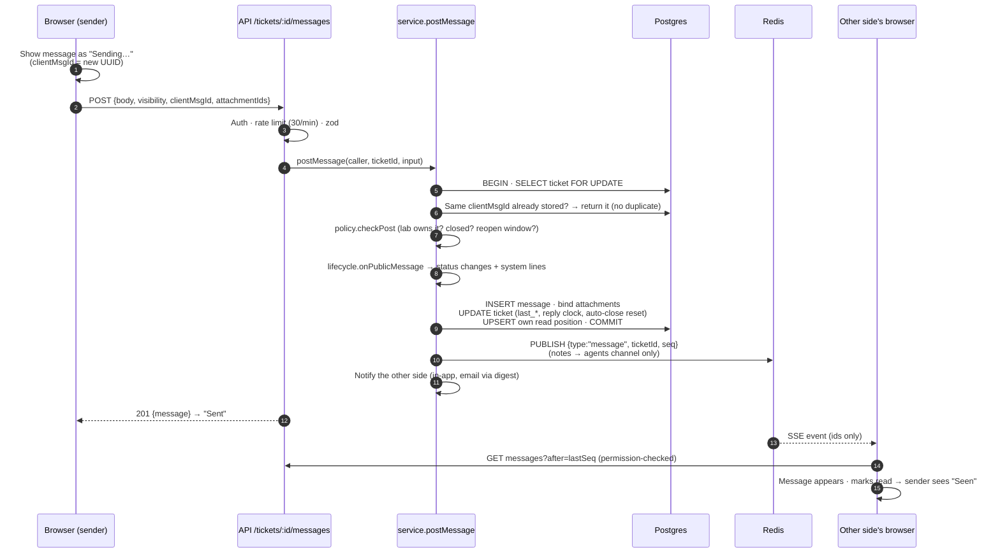

If the send fails, the bubble shows **Retry**. Retrying reuses the same `clientMsgId`, so the server never stores the message twice.

### 7.2 Agent actions (assign, priority, close, link…)

`POST /tickets/:id/actions` takes `{action, …}`. The service then:
1. Locks the ticket.
2. Checks the action is in `policy.allowedActions` for this person and state.
3. Runs `lifecycle.onAction`, which returns the column patch, the audit events and any system lines.
4. Recomputes the reply clock.
5. Commits.
6. Publishes a `ticket` event and sends notifications.

The API returns the fresh ticket, so the UI updates at once. If nothing changed, it returns quietly. If the conversation changed underneath the caller, it returns a 409 asking them to refresh.

### 7.3 Lab starts a conversation

1. **Starting point:** the **New conversation** dialog, the **widget**, or **Request a callback** (which uses category `callback`).
2. **One transaction:**
   - ticket row (status New, the clock starts, `first_response_due_at` is set)
   - first message and attachments
   - `created` event
   - the creator's read position
3. **After commit:**
   - live event to both sides
   - "New conversation" notification to **every agent** (in-app and email)
   - activity log entry
4. Starting a conversation is rate-limited to 10 per hour per person, and idempotent through `clientMsgId`.

---

## 8. Real-time updates

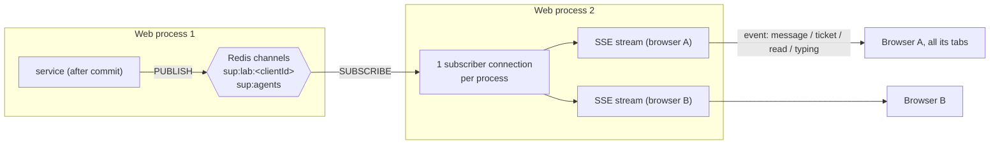

Support uses the app-wide live connection. How that works: [live-updates.guide.md](live-updates.guide.md).

| Topic | How it works |
|---|---|
| Channels | Labs listen on **their lab's** channel only; agents listen on `sup:agents`. Internal notes are published to agents only. |
| Event types | `message`, `ticket`, `read`, `typing`. They carry **ids only, never text**. The browser refetches through the normal API. |
| Connection | `GET /api/live`. One per **browser**: the tabs share it. |
| Reconnects | Events are counted. On (re)connecting, the browser refreshes support only if something was missed. |
| Keep-alive | Heartbeat every 25 s. `X-Accel-Buffering: no` for nginx. |
| Limits | Max 10 open streams per person. Signing out or losing access closes them at once; the session is also re-checked every 5 min. |
| Presence | An agent with a **visible** tab anywhere in the app in the last few minutes counts as online ("We're online" for labs). Presence is also used to skip emails to people who have the app open. |
| Typing | `POST /tickets/:id/typing` is ephemeral (never stored) and rate-limited. Typing an internal note is shown to staff only. |
| Fallback | While disconnected, the UI polls (thread 8 s, list 30 s). While connected, a safety refresh runs every 5 min. The open widget asks every minute whether support is online. |
| Redis down | No data is lost (Postgres is the source of truth). The UI updates through the safety poll until Redis is back. |

---

## 9. Attachments (up to 500 MB)

Files **never pass through our servers**. The browser uploads straight to Cloudflare R2 with presigned multipart URLs.

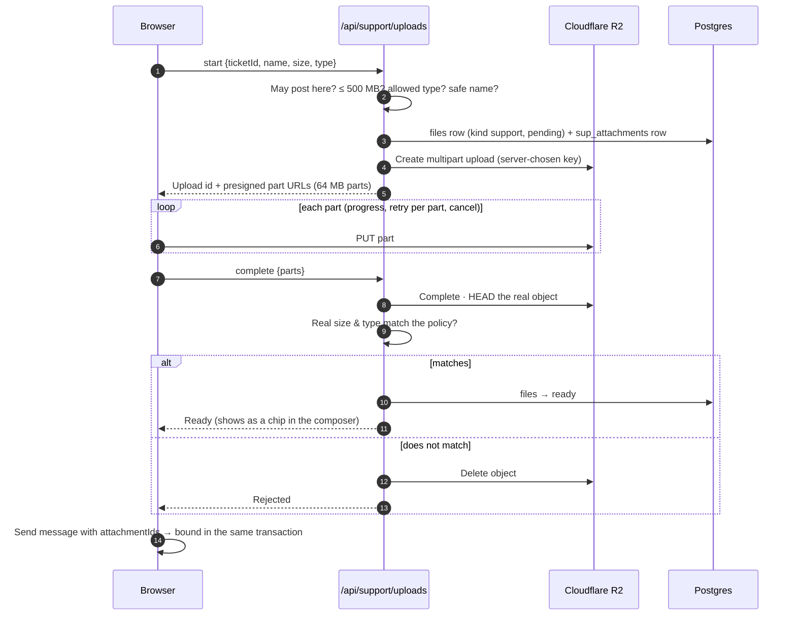

| Rule | Value |
|---|---|
| Max size | 500 MB per file, 10 files per message |
| Allowed | Images: jpg, png, webp, gif, heic · Video: mp4, mov, webm · Documents: pdf, txt, csv, docx, xlsx |
| Blocked | Executables and scripts, always |
| Binding | Only the uploader can attach the file, only to a message in the same conversation |
| Viewing | `GET /api/support/attachments/:id` checks access, then redirects to a 15-minute signed URL. Images show inline. Videos **stream with seeking** (HTTP Range); formats the browser can't play show a download button. |
| Retention | 3 months (the app-wide R2 policy). After that the message keeps its text and shows "File removed after 3 months". |
| Abandoned uploads | The hourly `support-upload-reaper` aborts or removes uploads never sent after 24 h (D6) |
| Drag and drop / paste | Anywhere on the conversation, or by pasting into the composer |

---

## 10. Reply-time targets (SLA), auto-close, emails and ratings

### 10.1 The reply clock

The clock answers one question: **how long has the lab been waiting on us?**

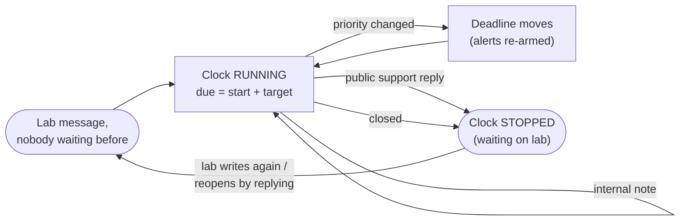

| Priority | First reply target | Next reply target |
|---|---|---|
| Urgent | 1 h | 2 h |
| High | 4 h | 8 h |
| Normal | 8 h | 24 h |
| Low | 24 h | 48 h |

- **First** target: until support's first public reply. **Next** target: every later wait.
- **Agents** see a badge in the inbox list and the conversation header:

  | Badge | When |
  |---|---|
  | `Reply in 3h` | On track |
  | `Reply in 40m` (amber) | Due soon: after 80 % of the time has gone |
  | `Overdue 1h` (red) | Past the target |

- The **Overdue** tab shows every open conversation past its target, with a count.
- **Labs never see** deadlines.
- Time runs **24/7** for now. Business hours (decision D5) are reserved in `sup_sla_policies.business_hours` but not used yet.

**Alerts** come from the `support-sla` job, which runs every minute:

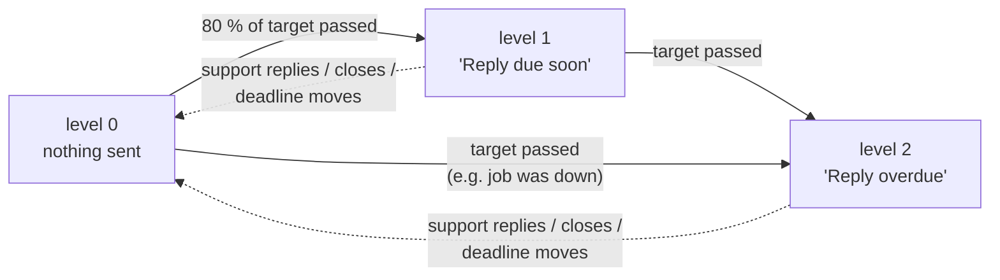

- **Who is alerted:** the assignee, or every agent while the conversation is unassigned.
- **How:** in-app only, never email.
- **No duplicates:** each alert is claimed by **one atomic `UPDATE … RETURNING`**. A reply committed at the same moment wins, and two workers can never both send the same alert.

### 10.2 Auto-close (decision D4: 7 days)

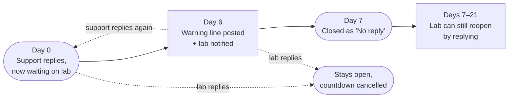

- The `support-auto-close` job runs every 15 minutes.
- **After 6 days** waiting on the lab, it posts a public line ("…will close automatically tomorrow. Reply here to keep it open.") and notifies the lab.
- Both sides then see a notice: "closes automatically on {date}".
- **Any public message cancels it**:
  - a lab reply cancels it entirely
  - a new support reply restarts the 6 days
- **A day after the warning**, it closes as **No reply** with no person attached (event `auto_closed`). The lab is notified and can reopen by replying within 14 days.
- Every candidate is **re-checked under the row lock**, so a reply that arrives mid-sweep always wins.

### 10.3 Unread-message emails (digests)

Single chat messages never email on their own, because that would flood inboxes. Instead, the `support-email-digest` job runs every minute and decides per person:

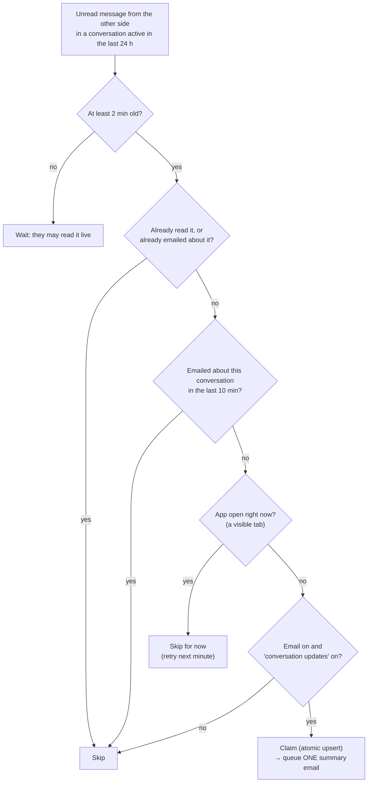

- **Recipients:**
  - the lab owner and the lab member who started the conversation, for support replies
  - the **assignee**, for lab messages

  Unassigned conversations already email every agent when they are created.
- **Email content:**
  - the last 3 messages, with "and N earlier"
  - a "Reply in IconicConnect" button with an absolute link (`NEXT_PUBLIC_APP_URL`)
  - every user-written text is **HTML-escaped**

### 10.4 Ratings (CSAT)

- **When:** after a conversation closes as **Resolved** or **No reply**, the lab sees **"How did we do?"** with 1–5 stars and an optional comment.
- **Who and how often:** anyone from that lab, **once**, within the 14-day reopen window. Duplicates and spam aren't rated.
- **Accessibility:** native radio buttons, so it works with the keyboard and screen readers.
- **Afterwards:** both sides see the stars and comment in the header, the assignee is notified, and the score feeds the lab panel average and team metrics.

### 10.5 Team metrics

`GET /api/support/metrics?days=7|30|90`, agents only, one aggregate query. The inbox header shows:

> Last 30 days: 42 new · first reply in 1h 12m (median) · 94% on time · rated 4.6/5 (18)

| Number | Definition |
|---|---|
| Median first reply | From a lab starting a conversation to the first public support reply. Conversations agents started are excluded. |
| On time % | First replies within target, out of those answered or already past their target |
| Auto-closed | Closed as No reply with no person attached |
| Overdue now | Open conversations past their reply target |

---

## 11. Security and privacy

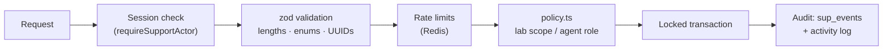

| Concern | Protection |
|---|---|
| Lab A seeing lab B | Every query is scoped by the caller's lab in SQL. Another lab's conversation returns **404** (not 403), so its existence isn't revealed. Tested for read, post, upload, subscribe, link and rate. |
| Internal notes leaking | Filtered in `queries.ts` (SQL), published only to the agents channel, never in lab notifications or emails, never searchable by labs |
| Live stream leaking content | Events carry ids only. Content is always fetched through permission-checked APIs. |
| Uploads | Server-chosen keys, private bucket, type and size verified **after** upload against the real object, executables blocked, short-lived signed URLs after an access check |
| Message content | Plain text, escaped on render (no HTML or markdown). Links get `rel="noopener noreferrer"`. Digest emails escape everything. |
| Linking | Same lab only; checked again when reading, so a link can never reveal another lab |
| Cross-site requests | The app proxy blocks state-changing API calls from other origins |
| Abuse | Rate limits on starting conversations, messages, uploads and typing. Max 10 streams per person. |
| Audit | Every change goes to `sup_events` and the activity log. Message bodies and secrets are never logged. |
| Designers | No access at all (D10) |

---

## 12. Critical cases and how they are handled

| Situation | What happens | Where |
|---|---|---|
| Double click on Send / flaky network retry | Stored once (`client_msg_id` unique per author); the retry returns the original | `service.postMessage`, unique index |
| Two agents act on the same conversation at once | The ticket row is locked; the second sees the new state. A conflicting action gets a 409 asking them to refresh. | `lockTicket` |
| Lab replies to a closed conversation within 14 days | Reopens to Live in the same transaction; a "reopened" line appears before the reply | `policy.checkPost`, `lifecycle.onPublicMessage` |
| …after 14 days | 409 "This conversation is closed". The UI offers **Start a new conversation** with the subject prefilled. | `ThreadView` |
| Lab replies at the same moment as auto-close | The sweep re-checks under the lock; the reply wins and the conversation stays open | `runAutoCloseSweep` |
| Support replies just as the SLA job fires | The atomic UPDATE no longer matches, so no stale alert | `runSlaSweep` |
| Several worker processes | Job schedulers run each tick once. Alert and email claims are atomic, so there are no duplicates. | `maintenance.ts`, `digest.ts` |
| Redis down | Writes still succeed (publishing is fire-and-forget). Live updates pause and the UI polls. Rate limits fail open. Presence is unknown, so digests treat people as away. | `realtime.ts` |
| Email provider failing | Business actions never fail because of email. Jobs are queued with retries; failures are logged. | `notification-service`, email queue |
| Upload interrupted | Per-part retry. Unsent uploads are reaped after 24 h. | `useUploads.ts`, upload reaper |
| File renamed to fake its type | The real object is checked after upload; a mismatch is deleted | `attachments.completeUpload` |
| File older than 3 months | Shows "File removed after 3 months"; the message stays | retention + `attachmentsForMessages` |
| Agent deleted | Their messages remain (`author_id → null`, shown as "Deleted user"); assignments are cleared | FK `ON DELETE SET NULL` |
| Lab deleted | All its conversations, messages and attachments are removed | FK `ON DELETE CASCADE` |
| Deploying Phase 5 onto existing data | Past-due deadlines are marked as already alerted, and conversations waiting on a lab start their auto-close countdown at deploy, so there's no alert or email storm | backfill in the Phase 5 migration |
| Notification from a job (no acting person) | Sent as actor `system` (the dispatcher drops payloads without an actor) | `notify.send` |
| Duplicate saved-reply shortcut | 409 `shortcut_taken` (the database error is unwrapped through Drizzle's `cause`) | `agent-tools.ts` |
| Hydration / page refresh on `?ticket=` | The viewer id comes from the API, not from the session in render, so it is stable | `getTicketDetail` |

---

## 13. Files: where everything lives

```text
db/migrations/
├── 20261122000100_support_system.sql         # enums, tickets, messages, reads, events, import of old tickets
├── 20261122000200_support_attachments.sql    # sup_attachments + files.support_ticket_id
├── 20261123000100_support_canned_replies.sql # saved replies (+3 shared)
└── 20261124000100_support_sla_csat.sql       # SLA policies, clock columns, digests, backfill

src/db/schema/support.ts                      # Drizzle tables & enums (exported from schema/index.ts)

src/lib/support/
├── constants.ts      # statuses, priorities, categories, labels, roles, windows (browser-safe)
├── types.ts          # API shapes: TicketSummary, TicketDetail, MessageView, metrics…
├── policy.ts         # WHO may do WHAT (pure)            ← single source of permission rules
├── lifecycle.ts      # WHAT a change does to a ticket (pure): status, events, system lines, auto-close
├── sla.ts            # reply-clock rules, deadlines, badge states (pure, browser-safe)
├── upload-policy.ts  # allowed types, sizes, safe names (pure)
├── validation.ts     # zod schemas for every request
├── http.ts           # auth (requireSupportActor), errors, rate limits, parsing
├── queries.ts        # READ side: lists, detail, messages, summary, agents (scoped; notes filtered)
├── service.ts        # WRITE side: create, post, read, actions, rating, SLA & auto-close sweeps
├── attachments.ts    # R2 multipart start/sign/complete/abort, binding, signed URLs, reaper
├── agent-tools.ts    # saved replies, lab context panel, team metrics (agents only)
├── channels.ts       # the two support channels
├── realtime.ts       # sends support's live events (the connection itself: src/lib/live)
├── notify.ts         # who hears about what (in-app + email through the notification service)
└── digest.ts         # unread-message email job

src/app/api/support/              # thin HTTP routes (see §14)
src/app/client/(dashboard)/support/page.tsx   # lab page      → <SupportWorkspace mode="customer">
src/app/admin/(dashboard)/support/page.tsx    # admin page    → <SupportWorkspace mode="agent">
src/app/(ops)/support/page.tsx                # QC / AM page  → <SupportWorkspace mode="agent">
src/components/ClientLayout.tsx               # mounts <SupportWidget/> on lab pages

src/components/support/
├── SupportWorkspace.tsx     # list + thread layout, views/tabs, filters, metrics line
├── TicketList.tsx           # conversation list with badges and unread dots
├── ThreadView.tsx           # one conversation: header, controls, messages, composer, side panel
├── MessageList.tsx          # bubbles, day separators, system lines, "Seen", load older
├── Composer.tsx             # text, notes toggle, attachments, "/" saved-reply picker
├── AgentControls.tsx        # assign, take it, priority, topic, link, close/reopen
├── CustomerPanel.tsx        # lab details, cases, other conversations, rating average
├── CannedRepliesDialog.tsx  # manage saved replies
├── RatingPrompt.tsx         # "How did we do?"
├── NewConversationDialog.tsx · CallbackDialog.tsx
├── SupportWidget.tsx        # floating chat on lab pages
├── Attachments.tsx · useUploads.ts   # upload chips, previews, video player, multipart uploader
├── live.ts                  # support's use of the live connection, typing
├── api.ts                   # TanStack Query hooks for every endpoint
└── parts.tsx                # badges (status, waiting, priority, SLA), stars, time formatting

src/lib/queue/maintenance.ts  # schedules support-sla, support-auto-close, support-email-digest, upload reaper
src/lib/notifications/*       # SUPPORT_* notification types, email/in-app switches

src/lib/__tests__/
├── support-rules.test.ts            # policy + lifecycle
├── support-upload-policy.test.ts    # file rules
├── support-sla.test.ts              # clock, deadlines, auto-close, rating rules
├── support-db.integration.test.ts           # core flows on real Postgres
├── support-attachments.integration.test.ts  # uploads and binding
├── support-realtime.integration.test.ts     # Redis events and presence
├── support-agent-tools.integration.test.ts  # saved replies, links, lab context
└── support-sla.integration.test.ts          # SLA, auto-close, ratings, digests, metrics
```

---

## 14. API reference

Every route needs a signed-in session with support access. Errors are JSON `{ error, code }`.

| Method | Path | Who | Purpose |
|---|---|---|---|
| GET | `/api/support/tickets?view=&q=&priority=&category=&cursor=` | Both | List. `view`: `open`, `closed`, `all`; agents also get `unassigned`, `mine`, `overdue`. Keyset paging. |
| POST | `/api/support/tickets` | Both | Start a conversation `{subject, category, message, clientMsgId, attachmentIds?, clientId? (agents), priority? (agents), relatedCaseId?, source?}` |
| GET | `/api/support/tickets/:id` | Both | Detail: allowed actions, read receipt position, rating, `canRate`, `autoCloseAt`, linked conversation; deadlines for agents only |
| GET | `/api/support/tickets/:id/messages?before=&after=&limit=` | Both | Thread page (notes only for agents) |
| POST | `/api/support/tickets/:id/messages` | Both | Send `{body, visibility: public, or note (agents only), clientMsgId, attachmentIds?}` |
| POST | `/api/support/tickets/:id/read` | Both | `{seq}`: read up to here |
| POST | `/api/support/tickets/:id/actions` | Both | `{action: close, reopen, assign, claim, set_priority, set_category or link, …}`, depending on what the caller is allowed |
| POST | `/api/support/tickets/:id/typing` | Both | Typing ping (ephemeral) |
| POST | `/api/support/tickets/:id/rating` | Lab | `{score 1–5, comment?}`, once |
| POST | `/api/support/uploads` | Both | Multipart upload steps: start, sign, complete, abort |
| GET | `/api/support/attachments/:id?download=1` | Both | Access check, then redirect to a short-lived signed URL |
| GET | `/api/support/summary` | Both | Badge counts: unread; plus new, mine and overdue for agents; agents online |
| GET | `/api/support/agents` | Agents | Active agents (assignment menu) |
| GET/POST | `/api/support/canned-replies` | Agents | List / create saved replies |
| PATCH/DELETE | `/api/support/canned-replies/:id` | Owner, or admin for shared ones | Edit / delete |
| GET | `/api/support/customers/:clientId/context?ticket=` | Agents | Lab side panel data |
| GET | `/api/support/metrics?days=7\|30\|90` | Agents | Team numbers |

**Common error codes:**

| Code | HTTP | Meaning |
|---|---|---|
| `not_found` | 404 | The conversation doesn't exist, or the caller has no access (another lab's conversation also returns this) |
| `forbidden` | 403 | |
| `action_not_allowed` | 403 | |
| `cannot_rate` | 403 | |
| `closed` | 409 | |
| `invalid_state` | 409 | |
| `already_rated` | 409 | |
| `shortcut_taken` | 409 | |
| `link_not_found` | 400 | |
| `rate_limited` | 429 | |
| `expired` | 410 | The attachment was removed after 3 months |

---

## 15. Configuration, limits and defaults

| Setting | Value | Where to change |
|---|---|---|
| Statuses | New / Live / Closed | `constants.ts` (design decision, not a setting) |
| Reopen window | 14 days | `REOPEN_WINDOW_DAYS` in `constants.ts` |
| Auto-close | 7 days (warning at day 6) | `AUTO_CLOSE_DAYS` |
| Reply targets | See §10.1 | `sup_sla_policies` table (cached 60 s); `DEFAULT_SLA_POLICIES` as a fallback |
| "Due soon" point | 80 % | `SLA_WARN_RATIO` in `sla.ts` |
| Digest | 2 min grace, 10 min throttle, 24 h lookback, 3 messages shown | constants at the top of `digest.ts` |
| Attachments | 500 MB, 10 per message, 64 MB parts, 3-month retention | `upload-policy.ts` |
| Rate limits | Start: 10/h · messages: 30/min · uploads: 20/h · typing: 30/min | `LIMITS` in `http.ts` |
| Live connection | Heartbeat 25 s, session check 5 min, 10 streams per person, safety refresh 5 min | `src/lib/live/stream.ts`, `presence.ts`, `client.ts` |
| Message length | 10,000 characters; subject 200 | `constants.ts`, DB checks |
| Email links | `NEXT_PUBLIC_APP_URL` | `.env` |
| Email sending | `RESEND_API_KEY` | `.env`. Use a dummy value locally to avoid sending real emails. |

---

## 16. Testing

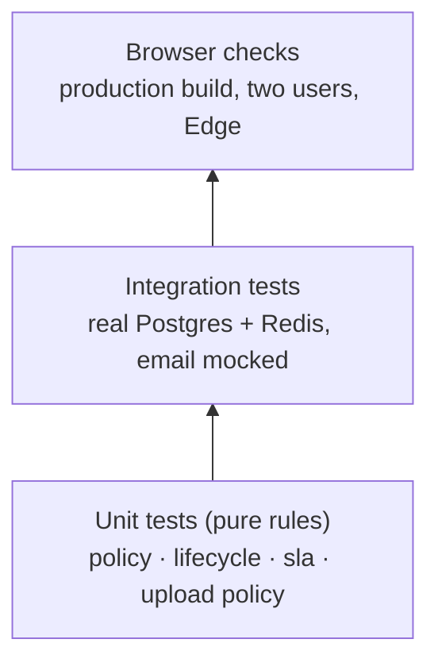

| Level | What | How to run |
|---|---|---|
| Unit | Permissions, transitions, clock, deadlines, auto-close timing, rating eligibility, file rules | `npx vitest run support-` (always on) |
| Integration | Lab isolation, idempotent sends, notes never reaching labs, live events across processes, attachments, saved replies, links, SLA alerts, auto-close, ratings, digests, metrics | `SUPPORT_DB_TEST=1 DATABASE_URL=<local> REDIS_URL=redis://localhost:6380 npx vitest run support-` |
| Browser | Each phase: end-to-end with a lab user and an agent (two server processes for live tests) | Puppeteer scripts used during development |

The integration tests create throwaway labs and agents, and delete everything they created. **Never point them at production.**

---

## 17. Operating it

**Deploying:**
1. Run the four support migrations (`dbmate up`).
2. Restart the web and worker processes. The worker registers the support jobs (BullMQ job schedulers in Redis) on boot.
3. Check that `NEXT_PUBLIC_APP_URL` is the public URL, because digest emails link to it.

**Background jobs** (all in the existing maintenance worker, concurrency 1):

| Job | Every | Does |
|---|---|---|
| `support-sla` | 1 min | "Due soon" and "Overdue" alerts |
| `support-auto-close` | 15 min | Warn at day 6, close at day 7 |
| `support-email-digest` | 1 min | Unread-message emails |
| `support-upload-reaper` | 1 h | Removes uploads never sent |

**Useful SQL:**

```sql
-- Change a reply target (takes effect within a minute)
UPDATE sup_sla_policies SET first_response_minutes = 120 WHERE priority = 'high';

-- What's overdue right now
SELECT number, subject, reply_due_at FROM sup_tickets
WHERE status <> 'closed' AND reply_due_at <= now() ORDER BY reply_due_at;

-- A conversation's audit trail
SELECT created_at, type, from_value, to_value, actor_id FROM sup_events
WHERE ticket_id = '<id>' ORDER BY created_at;
```

**Health signals:**
- Worker logs show `[Maintenance] support auto-close: N warned, M closed`.
- Failed jobs are logged as `[Maintenance] <job> failed: …`.
- Email failures appear in the email queue's failed set.

---

## 18. Known limits and what's next

| Limit | Notes / next step |
|---|---|
| Business hours (D5) | Targets count 24/7. Add a timezone and working hours, then pause the clock outside them (`business_hours` column reserved). |
| Account managers see every lab (D3) | Needs a lab ↔ manager link to scope "my labs" |
| Message edit / delete | The schema has `edited_at` and `deleted_at`; there's no UI yet |
| Formatting | Plain text only, by design in v1 |
| Admin UI for reply targets | Edited in SQL today |
| Old support tables | Still present (deprecated); drop them once nothing reads them |
| General notification emails | The shared email template (outside support) doesn't escape text; worth fixing app-wide |

---

## 19. Glossary

| Term | Meaning |
|---|---|
| **Conversation / ticket** | One support thread (`sup_tickets`) |
| **Agent** | Admin, QC or account manager working the inbox |
| **Lab / customer** | Lab owner (`client`) or lab member (`subuser`) |
| **Internal note** | A message only agents can see |
| **System line** | A centred, author-less line in the thread ("Conversation closed by …") |
| **seq** | Global message order number, used for paging, unread status and receipts |
| **Reply clock / SLA** | How long the lab has been waiting on support, against a target |
| **Digest** | A throttled email summarising unread messages |
| **CSAT** | Customer satisfaction rating (1–5) |
| **Saved reply** | A reusable reply inserted with `/shortcut` |
| **Live connection / SSE** | The server-sent events connection that pushes updates to the browser |
